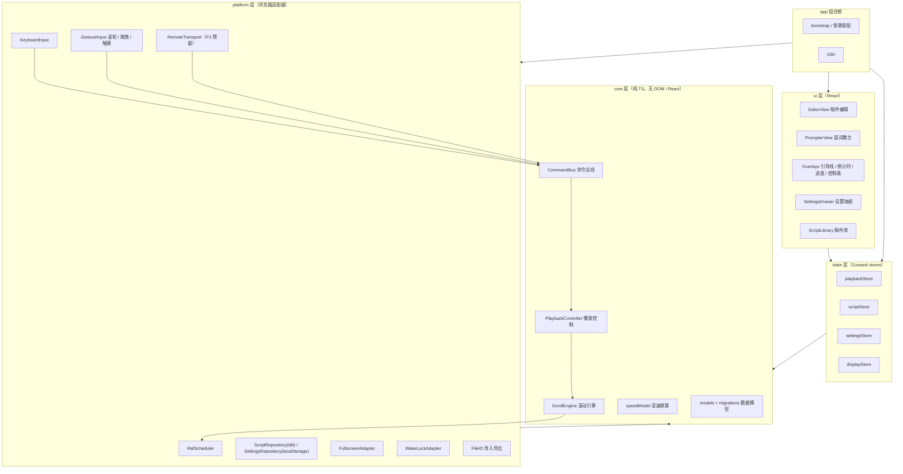
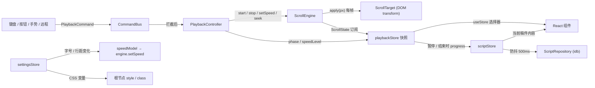
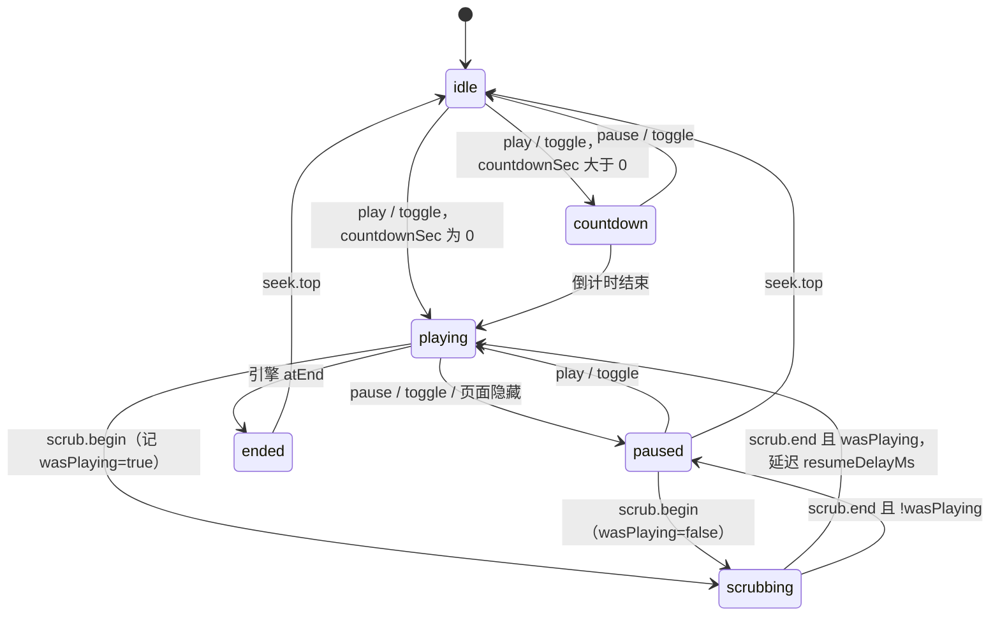
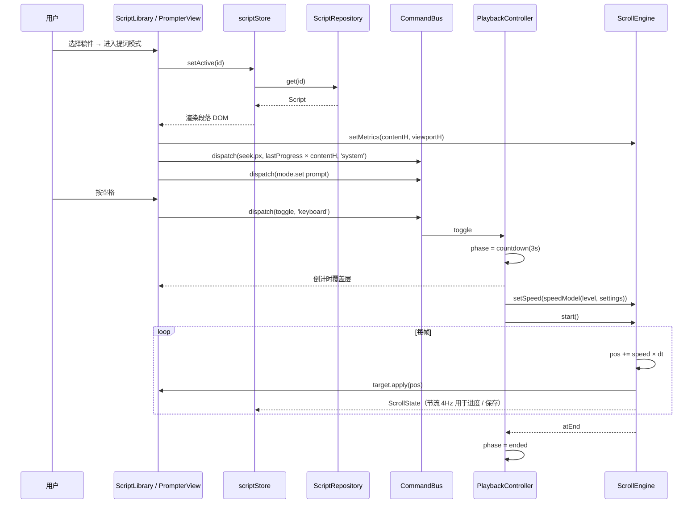
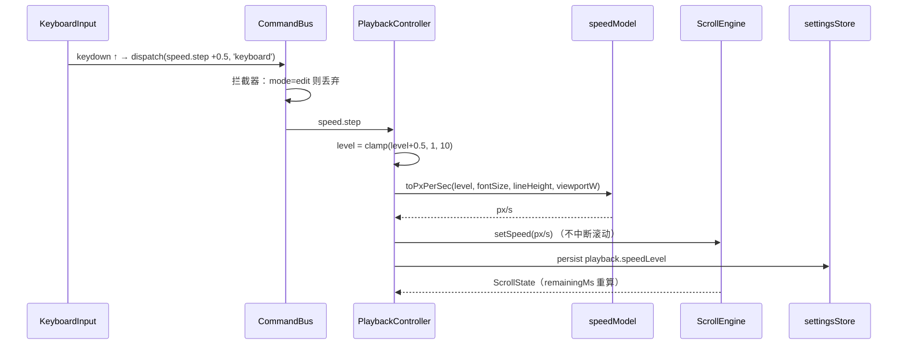
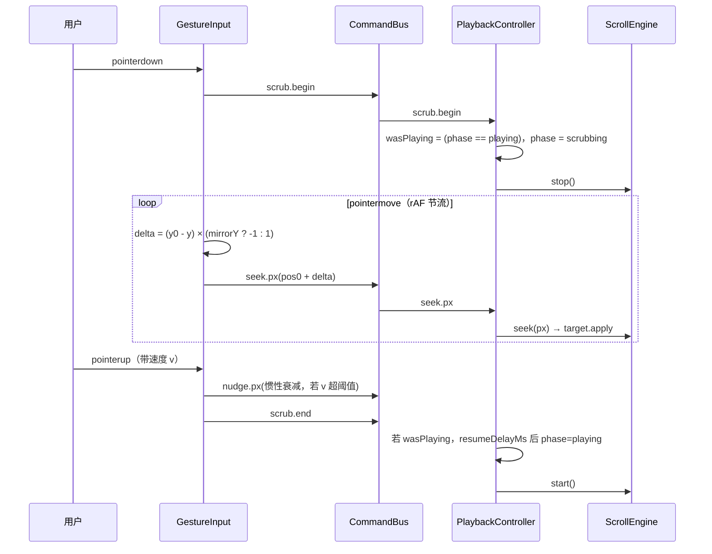
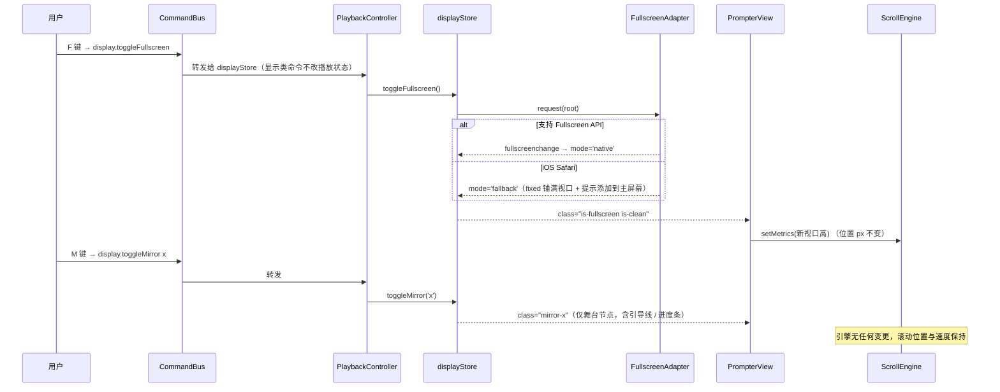
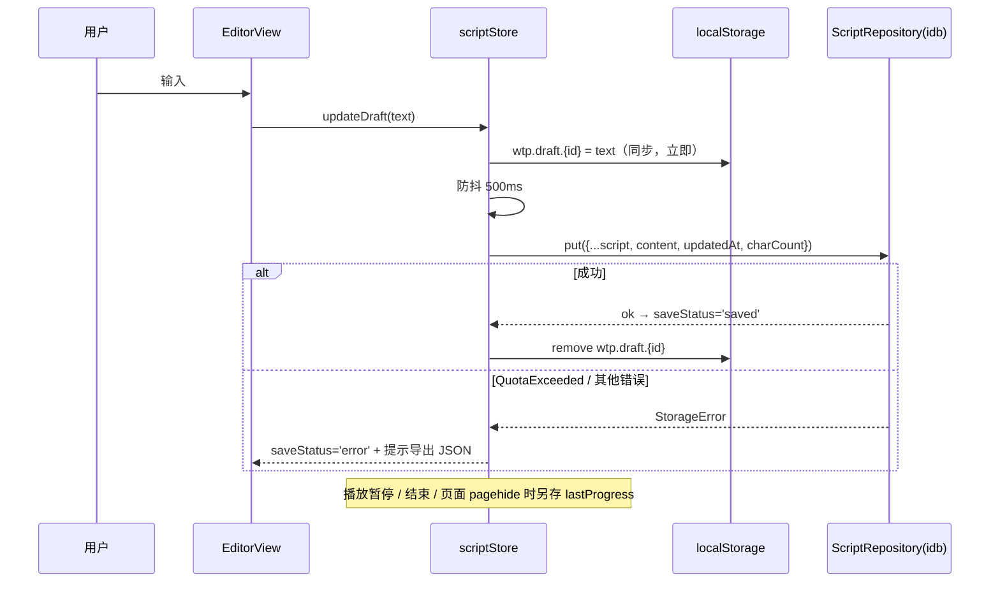

# WebTeleprompter 顶层架构设计

> **相关文档**：[产品规划（product-plan.md）](./product-plan.md) —— 本文所有 P0/P1/P2 编号均引用该文档第 4 节。

本文为设计文档，不含应用代码；TypeScript 片段仅用于描述接口契约。

## 1. 设计目标与约束

| 维度 | 目标 / 约束 | 说明 |
| --- | --- | --- |
| 部署形态 | 纯前端静态站点，无后端即可上线 | 产物为静态文件，部署到 GitHub Pages / Vercel / Cloudflare Pages；所有数据留在浏览器本地 |
| 滚动性能 | 提词滚动 ≥ 55fps（P95），目标 60fps；5 万字稿件下仍成立 | 滚动路径上零布局（layout）、零绘制（paint）开销，仅 composite |
| 首屏 | 首屏可交互（TTI）< 1.5s（4G 中端手机）；主 JS 包 gzip < 120KB | 设置面板、稿件库、导入导出等非首屏模块按需拆包 |
| 可靠性 | 刷新、崩溃、误关页面均不丢稿 | 编辑防抖 500ms 自动保存；写入失败有可见提示与 JSON 导出兜底 |
| 兼容范围 | 桌面：Chrome / Edge / Firefox / Safari 近两个大版本；移动：iOS Safari 15+、Android Chrome 近两个大版本 | iOS Safari 无 Fullscreen API（iPhone），Wake Lock 需 HTTPS + 用户手势，均需降级路径 |
| 可扩展性 | P1/P2 功能以"新增模块 / 新增适配器"方式接入，不修改核心引擎 | 控制输入统一走命令总线；滚动引擎与 UI 框架解耦；存储有 schema 版本 |
| 隐私 | 不采集稿件内容；无账号 | 若 P2 引入云同步，必须是显式开启的可选项 |

### 1.1 可扩展性原则

1. **核心与宿主分离**：`core` 层只依赖 TypeScript 标准库，通过接口注入时钟、存储、DOM 能力，可在 Node 中单元测试。
2. **输入即命令**：键盘、按钮、触摸、未来的远程 / 语音 / 脚踏板，全部产生 `PlaybackCommand`，进入同一个控制器；新增输入源不触碰播放逻辑。
3. **单一位置写者**：滚动位置只由滚动引擎写入，手动拖拽、滚轮也通过命令改变引擎内部位置，避免双写抖动。
4. **数据带版本**：稿件、设置、导出文件均含 `schemaVersion`，迁移链单向递增。
5. **显示属性 CSS 化**：镜像、纯净模式、配色、字号全部映射为根节点 class / CSS 变量，滚动引擎对这些变化无感知。

## 2. 技术选型

| 领域 | 选择 | 备选 | 选择理由与权衡 |
| --- | --- | --- | --- |
| 构建 | Vite 5 + TypeScript 5（strict） | — | 规划已建议；冷启动快、Rollup 产物小、原生支持代码分割与 PWA 插件（P2 预留） |
| UI 框架 | **React 18** | Vue 3、Svelte | 三者均可胜任。选 React 的决定性因素：(a) 生态与招聘面最广，Zustand、Testing Library、Playwright 组件测试支持成熟；(b) 并发特性（`useSyncExternalStore`）可无缝订阅框架外的 store，契合"引擎脱离框架"的设计。代价：包体比 Svelte 大约 35KB gzip，可接受 |
| 状态管理 | **Zustand**（`zustand/vanilla` + React 绑定） | Jotai、Redux Toolkit | vanilla store 可在 `core`/`platform` 层无 React 使用；API 极小；支持 `subscribe` 选择器，便于把状态变化桥接到引擎。Redux 过重；Jotai 以原子为中心，跨层共享不如 store 直观 |
| 样式 | CSS Modules + CSS 自定义属性（主题变量） | Tailwind、CSS-in-JS | 零运行时；主题 / 镜像 / 纯净模式用根节点 class 与变量切换，与性能目标一致。Tailwind 对"用户可调任意字号颜色"场景无优势；CSS-in-JS 有运行时开销 |
| 存储 | `idb`（IndexedDB 轻封装）+ `localStorage` | Dexie、localForage | `idb` 仅 ~1KB，Promise 化即可；Dexie 功能过剩。设置量小且需同步读取（首屏避免闪烁）走 `localStorage` |
| 单元测试 | Vitest + `fake-indexeddb` + `@testing-library/react` | Jest | 与 Vite 共用配置；`fake-indexeddb` 让存储层可在 Node 测 |
| E2E | Playwright（Chromium / WebKit / Firefox） | Cypress | 可测 WebKit（接近 iOS Safari）、可控 `requestAnimationFrame` 与性能 trace |
| 代码质量 | ESLint（含 `import/no-restricted-paths` 强制依赖方向）+ Prettier | — | 用 lint 规则把第 3 节的禁止依赖固化下来 |
| i18n | 自研极简 `t(key)` + JSON 词典（首期仅 zh-CN） | i18next | 首期不引入库，但所有文案走 `t()`，P1 以后可替换实现 |

## 3. 顶层架构

### 3.1 分层与模块图



> 箭头表示"允许依赖 / 调用"方向。`platform → core` 仅限实现 `core` 定义的接口与向总线发命令。

### 3.2 模块职责与边界

| 模块 | 层 | 职责 | 拥有的状态 | 禁止 |
| --- | --- | --- | --- | --- |
| `ScrollEngine` | core | rAF 驱动按时间增量推进位置；`seek`/`nudge`；边界检测（到顶 / 到底）；对外发 `ScrollState` | `positionPx`、`speedPxPerSec`、`running`、`contentHeightPx`、`viewportHeightPx` | import React / DOM / 任何 store；直接读写样式 |
| `PlaybackController` | core | 接收 `PlaybackCommand`，依据模式与阶段做状态机转换（倒计时、播放、暂停、结束、拖拽中），调用引擎 | `phase`、`countdownRemainingMs`、`speedLevel`、`mode` | 直接操作 DOM；知道按键名 |
| `CommandBus` | core | 命令的统一入口；按来源打标签；提供拦截（如编辑态屏蔽） | 无（无状态分发） | 持有业务逻辑 |
| `speedModel` | core | 纯函数：`speedLevel × 排版参数 → px/s`；剩余时间估算；字数 / 时长估算 | 无 | 副作用 |
| `models/migrations` | core | `Script`、`Settings`、`ExportBundle` 类型与校验；版本迁移链 | 无 | I/O |
| `playbackStore` | state | 镜像 `Controller` 与 `Engine` 的只读快照供 UI 订阅；暴露 `dispatch` | 快照（派生） | 自行修改位置 |
| `scriptStore` | state | 稿件列表、当前稿件、草稿、保存状态、自动保存调度 | `scripts[]`、`activeScriptId`、`draft`、`saveStatus` | 直接调用 idb（必须经 Repository） |
| `settingsStore` | state | 外观 / 行为设置的读改存，派生 CSS 变量 | `Settings` | 知道滚动位置 |
| `displayStore` | state | 全屏模式、纯净模式、控件自动隐藏、设备类别、Wake Lock 状态 | `fullscreenMode`、`isClean`、`controlsVisible`、`viewportClass`、`wakeLock` | 存储稿件 |
| `RafScheduler` | platform | 实现 `FrameScheduler`：封装 rAF 与 `visibilitychange`，后台恢复时不产生巨大 dt | — | 业务逻辑 |
| `KeyboardInput` / `GestureInput` | platform | DOM 事件 → `PlaybackCommand`；镜像下拖拽方向反向映射 | 手势瞬时状态（按下点、速度） | 修改 store |
| `ScriptRepository` / `SettingsRepository` | platform | IndexedDB / localStorage 的 CRUD、容量错误归一化、迁移触发 | — | UI 提示 |
| `FullscreenAdapter` | platform | 原生 Fullscreen API 与 iOS "页面内全屏"降级的统一接口 | — | — |
| `WakeLockAdapter` | platform | 申请 / 释放 / 失焦重申请 Wake Lock；不支持时返回 `unsupported` | — | — |
| `FileIO` | platform | `.txt` / `.json` 导入导出、文件名生成 | — | 解析业务规则（交给 models） |
| `RemoteTransport` | platform | **P1 预留**接口：收发序列化命令与状态；首个实现为 `BroadcastChannel` | 连接状态 | — |

### 3.3 依赖方向规则（ESLint 固化）

| 规则 | 内容 |
| --- | --- |
| R1 | `core` 不得 import `react`、`zustand/react`、`platform/*`、`ui/*`、`state/*`；只允许 `zustand/vanilla` 类型（可选）与标准库 |
| R2 | `platform` 只能依赖 `core` 的接口与类型，不得依赖 `ui`、`state` |
| R3 | `ui` 只能通过 `state` 的 hooks 访问数据与 `dispatch`，不得直接 import `core/ScrollEngine` 实例或 `platform` |
| R4 | 仅 `app/bootstrap` 可以 `new` 具体实现并完成装配（依赖注入点唯一） |
| R5 | 任何模块不得直接写滚动位置相关 DOM 样式，`PrompterView` 中的 `ScrollTarget` 实现是唯一例外 |

### 3.4 源码目录结构

```text
src/
  app/          bootstrap.ts（装配）、App.tsx、i18n/
  core/         scroll-engine/、playback/（controller、commands、bus）、speed-model/、models/、migrations/
  platform/     raf/、input/（keyboard、gesture）、storage/、fullscreen/、wake-lock/、file-io/、remote/
  state/        playbackStore、scriptStore、settingsStore、displayStore、hooks/
  ui/           editor/、prompter/（Stage、overlays）、settings/、library/、shared/
  styles/       tokens.css（CSS 变量）、themes/、modes.css（mirror / clean / fullscreen class）
  locales/      zh-CN.json
```

`core` 与 `platform` 各自带 `__tests__`；E2E 放仓库根 `e2e/`。

### 3.5 P1 / P2 扩展点映射

| 规划功能 | 优先级 | 接入点 | P0 需预留的内容 |
| --- | --- | --- | --- |
| 远程控制（扫码） | P1 | 新增 `platform/remote/*Transport` 实现，向 `CommandBus` 发命令、订阅 `playbackStore` 回传状态；UI 增加配对面板 | `RemoteTransport` 接口、`CommandSource: 'remote'`、命令可 JSON 序列化 |
| 文本格式化 | P1 | `Script.format` 字段 + `ui/prompter` 的段落渲染器策略；编辑器切换为轻量 Markdown 子集 | `content` 保持纯字符串；渲染器通过单一 `renderParagraphs(script)` 函数接入 |
| 循环 / 段落停顿 | P1 | `PlaybackController` 新增 `atEnd` 分支与"段落边界暂停"规则；`Settings.playback` 加字段 | 引擎上报 `atEnd` 与段落偏移数组 |
| OBS 浏览器源模式 | P1 | `displayStore.presentation = 'obs'`（URL `?mode=obs`）：透明背景、禁交互、默认纯净 | 背景色由 CSS 变量承载；舞台与控件分节点 |
| 语音跟读 | P2 | 新增 `platform/voice` 输入源，产出 `seek.anchor { charIndex }` 命令；引擎增加 charIndex → px 查表 | 命令联合类型可扩展；段落 / 字符偏移测量放在 `setMetrics` 旁 |
| PWA 离线 | P2 | `vite-plugin-pwa` + manifest；无代码结构变化 | 全部资源静态、无运行时后端依赖 |
| 云同步 / 账号 | P2 | `ScriptRepository` 之上增加 `SyncService`（本地优先、冲突以 `updatedAt` + `remoteRev` 解决） | `Script` 加 `remoteRev`、`deletedAt` 为向后兼容字段 |
| 画中画 / 蓝牙遥控 | P2 | 前者是 `FullscreenAdapter` 的新 `mode`；后者是 `KeyboardInput` 的键位映射表 | 无额外预留 |

## 4. 模块交互协议

### 4.1 核心接口

```ts
// core/scroll-engine
export interface FrameScheduler {
  request(cb: (nowMs: number) => void): number;
  cancel(id: number): void;
}

export interface ScrollTarget {
  /** 引擎每帧回调，由显示层实现为 transform: translate3d(0, -y, 0) */
  apply(positionPx: number): void;
  /** 测量：内容总高、视口高（由显示层在 resize/字号变化后调用 engine.setMetrics） */
}

export interface ScrollState {
  positionPx: number;          // 内容相对阅读线的偏移，0 = 首行对准阅读线
  speedPxPerSec: number;
  running: boolean;
  atStart: boolean;
  atEnd: boolean;
  progress: number;            // 0..1，按 positionPx / contentHeightPx
  estimatedRemainingMs: number | null;
}

export interface ScrollEngine {
  start(): void;
  stop(): void;
  setSpeed(pxPerSec: number): void;
  seek(positionPx: number): void;        // 绝对定位（拖拽、跳段、回顶）
  nudge(deltaPx: number): void;          // 相对微调（滚轮）
  setMetrics(m: { contentHeightPx: number; viewportHeightPx: number }): void;
  getState(): ScrollState;
  subscribe(listener: (s: ScrollState) => void): () => void;
}
```

```ts
// core/playback
export type PlaybackPhase = 'idle' | 'countdown' | 'playing' | 'paused' | 'scrubbing' | 'ended';
export type AppMode = 'edit' | 'prompt';

export type PlaybackCommand =
  | { type: 'toggle' }                       // 空格 / 双击
  | { type: 'play' } | { type: 'pause' }
  | { type: 'speed.step'; delta: number }    // ↑↓，单位：档
  | { type: 'speed.set'; level: number }
  | { type: 'seek.top' }                     // Home
  | { type: 'seek.paragraph'; dir: 1 | -1 }  // PageUp / PageDown
  | { type: 'seek.px'; positionPx: number }  // 拖拽
  | { type: 'nudge.px'; deltaPx: number }    // 滚轮
  | { type: 'scrub.begin' } | { type: 'scrub.end' }
  | { type: 'mode.set'; mode: AppMode }
  | { type: 'display.toggleMirror'; axis: 'x' | 'y' }
  | { type: 'display.toggleFullscreen' };

export type CommandSource = 'keyboard' | 'button' | 'gesture' | 'remote' | 'voice' | 'system';

export interface CommandBus {
  dispatch(cmd: PlaybackCommand, source: CommandSource): void;
  /** 拦截器：返回 false 则丢弃（如编辑态屏蔽空格） */
  use(interceptor: (cmd: PlaybackCommand, source: CommandSource) => boolean): () => void;
}
```

```ts
// platform/remote（P1 预留，P0 仅定义接口）
export interface RemoteTransport {
  send(msg: { kind: 'command'; cmd: PlaybackCommand } | { kind: 'state'; state: ScrollState; phase: PlaybackPhase }): void;
  onMessage(cb: (msg: unknown) => void): () => void;
  readonly status: 'disconnected' | 'connecting' | 'connected';
}
```

### 4.2 状态所有权与流向



| 状态 | 唯一所有者 | 读者 | 变更途径 |
| --- | --- | --- | --- |
| 滚动位置、px/s 速度、running | `ScrollEngine` | playbackStore → UI、进度条、scriptStore（保存位置） | 仅 `PlaybackController` 调用引擎方法 |
| phase、speedLevel、mode、倒计时 | `PlaybackController` | playbackStore → UI | 仅通过 `CommandBus` |
| 稿件列表、当前稿件、草稿 | `scriptStore` | EditorView、ScriptLibrary、PrompterView | store actions；持久化经 Repository |
| 外观 / 行为设置 | `settingsStore` | 所有 UI、speedModel | store actions；同步写 localStorage |
| 全屏 / 纯净 / 控件可见 / WakeLock | `displayStore` | PrompterView、Overlays | store actions；由 FullscreenAdapter 事件回写 |

### 4.3 跨模块通信方式使用规则

| 方式 | 用于 | 禁用于 |
| --- | --- | --- |
| **CommandBus（命令）** | 一切"用户意图"：播放控制、调速、定位、切换镜像 / 全屏 | 数据读取、设置修改（设置不是播放意图） |
| **Store 订阅（状态）** | UI 读取状态；模块间"状态变了就重算"（字号变 → 重算速度） | 触发一次性动作（不要用 store 字段当事件用） |
| **直接调用（接口注入）** | Controller → Engine；Store → Repository；Engine → ScrollTarget / FrameScheduler | UI → Engine；platform → Store |
| **DOM 事件** | 只允许在 `platform` 适配器内部监听，立即转为命令或 store 更新 | `core`、`state` |

补充规则：命令处理必须是同步、幂等的；`seek.px` 等高频命令由适配器在 rAF 内节流到每帧最多一次。

### 4.4 播放状态机



| 规则 | 内容 |
| --- | --- |
| 调速 | `speed.*` 在任何阶段均可执行，仅改 `speedLevel` 与引擎速度，不改阶段 |
| 定位 | `seek.*` / `nudge.*` 在 `playing` 下不改阶段（播放中滚轮为"临时微调"）；在 `ended` 下自动回到 `paused` |
| 模式切换 | `mode.set edit` 强制进入 `paused`（若在播放）并停止引擎；`CommandBus` 拦截器在 `edit` 模式丢弃除 `mode.set` 外的全部命令 |
| 显示命令 | `display.*` 不经状态机，直接转交 `displayStore` |
| 保存点 | 进入 `paused` / `ended`、`pagehide` 时把 `progress` 写回当前稿件 |

## 5. 核心数据模型

### 5.1 类型定义

```ts
export interface Script {
  id: string;               // UUID v4
  title: string;
  content: string;          // 纯文本，\n 分段；P1 文本格式化将增加 format: 'plain' | 'md-lite'
  createdAt: number;        // epoch ms
  updatedAt: number;
  lastPositionPx: number;   // 上次播放位置（随字号变化会失真，恢复时按 progress 比例换算）
  lastProgress: number;     // 0..1，用于跨字号恢复
  charCount: number;        // 冗余，供列表展示
  schemaVersion: 1;
}

export interface Settings {
  schemaVersion: 1;
  appearance: {
    fontSizePx: number;      // 24–120
    lineHeight: number;      // 1.2–2.0
    fontFamily: 'sans' | 'serif' | 'mono';
    fgColor: string; bgColor: string; preset: 'black-white' | 'black-yellow' | 'white-black' | 'custom';
    paddingXPercent: number;
  };
  display: {
    mirrorX: boolean; mirrorY: boolean;
    guide: { style: 'line' | 'band' | 'mask'; positionPercent: number; opacity: number };
    showProgressInClean: boolean;
  };
  playback: {
    speedLevel: number;      // 1–10，步进 0.5
    countdownSec: number;    // 0–10
    resumeDelayMs: number;   // 拖拽松手后恢复，默认 300
  };
  locale: 'zh-CN';
}

export interface PlaybackState {       // playbackStore 对 UI 暴露的快照（派生，不持久化）
  mode: AppMode; phase: PlaybackPhase;
  speedLevel: number; countdownRemainingMs: number;
  scroll: ScrollState;
}

export interface ExportBundle {          // .json 备份文件
  app: 'webteleprompter'; schemaVersion: 1; exportedAt: number;
  scripts: Script[]; settings?: Settings;
}
```

### 5.2 本地存储 schema

| 存储 | 键 / 对象仓库 | 内容 | 说明 |
| --- | --- | --- | --- |
| IndexedDB `wtp` v1 | `scripts`（keyPath `id`，索引 `updatedAt`） | `Script` | 单稿 ≤ 5 万字符由 UI 提示，不在存储层截断 |
| IndexedDB `wtp` v1 | `meta`（keyPath `key`） | `activeScriptId`、`seededSample: true` | 首次打开预置示例稿 |
| localStorage | `wtp.settings` | `Settings` JSON | 同步读，首屏前注入 CSS 变量防闪烁 |
| localStorage | `wtp.draft.<scriptId>` | 最近一次未落库的草稿文本 | 防 idb 写入失败或 500ms 窗口内崩溃；成功落库后删除 |

### 5.3 版本与迁移策略

| 规则 | 内容 |
| --- | --- |
| 版本号 | `Script`、`Settings`、`ExportBundle` 各自独立 `schemaVersion`；IndexedDB 数据库版本号与 `Script.schemaVersion` 同步递增 |
| 迁移链 | `migrations/script.ts` 导出 `[(v1)=>v2, (v2)=>v3, …]`，启动时在 `onupgradeneeded` 内逐条执行；`Settings` 在读取时迁移并回写 |
| 读取容错 | 任何字段缺失用默认值补齐（`zod` 或手写校验），校验失败的稿件移入 `meta.quarantine` 并提示导出，不删除 |
| 导入 | 导入旧版本 `ExportBundle` 先跑迁移链再入库；`id` 冲突时生成新 id 并在标题后加"(导入)" |
| P1 预留 | `content` 旁增加 `format` 字段即可承载格式化文本；P2 云同步增加 `remoteRev`、`deletedAt`（软删除）字段，均为向后兼容的新增字段 |

## 6. 关键流程时序图

### 6.1 加载稿件并开始播放



### 6.2 快捷键调速



### 6.3 拖拽手动定位



### 6.4 全屏 / 镜像切换



### 6.5 自动保存



## 7. 非功能设计

### 7.1 性能

| 关注点 | 设计 |
| --- | --- |
| 滚动路径 | 位置变化只写一个内容层的 `transform: translate3d`，`will-change: transform`；不改 `scrollTop`、不改布局属性。镜像用父节点 `transform: scale(-1,1)`，与内容层分离，避免重算 |
| 亚像素平滑 | 引擎内部位置为浮点，transform 支持亚像素，低速（<30px/s）也不会出现整数 `scrollTop` 的卡顿 |
| 后台恢复 | `RafScheduler` 对单帧 dt 上限 100ms 截断；`visibilitychange` 隐藏时引擎自动 `stop`，恢复时保持暂停（与规划"不跳跃"一致） |
| 度量时机 | 内容高度只在稿件变化、字号 / 行距 / 边距变化、`resize` 后用 `ResizeObserver` 测一次并 `setMetrics`，不在帧循环内读布局 |
| 长文本 | 5 万字 ≈ 2–3 千行，几百个段落 `<p>`，DOM 规模可接受；合成层按 tile 处理，不需要虚拟化。段落加 `content-visibility: auto` 作为低成本优化。**虚拟化不进 P0**，验收 8-4 未达标时再评估（见第 9 节） |
| 首屏 | 设置从 localStorage 同步读取并在 `<head>` 内联脚本写 CSS 变量；`SettingsDrawer`、`ScriptLibrary`、`FileIO` 动态 import |
| 状态更新频率 | 引擎每帧直写 DOM，不经 React；`ScrollState` 推送给 store 节流到 4–10Hz，仅用于进度条与剩余时间 |

### 7.2 错误处理与降级

| 场景 | 处理 |
| --- | --- |
| IndexedDB 不可用（隐私模式等） | Repository 降级为内存 + localStorage，顶部常驻提示"本次数据不会长期保存，请导出" |
| 写入配额超限 | 保留草稿到 localStorage，提示导出 JSON；不丢当前编辑 |
| Fullscreen 不支持 / 被拒 | 页面内全屏降级；状态以 `fullscreenMode: 'native' | 'fallback' | 'none'` 表达 |
| Wake Lock 不支持 / 失败 | 静默降级，设置面板显示"无法阻止熄屏"提示；`visibilitychange` 回到前台后自动重新申请 |
| 稿件数据损坏 | 隔离而非删除，可导出；其余稿件正常加载 |
| 渲染异常 | React Error Boundary 包裹舞台与编辑器，兜底界面保留"导出全部数据"按钮 |

### 7.3 可访问性

- 所有控制按钮有 `aria-label` 与可见焦点环；快捷键与按钮一一对应，`?` 弹出快捷键表。
- 倒计时、"已暂停"、"已结束"通过 `aria-live="polite"` 区域播报。
- 配色预设保证对比度 ≥ 7:1；自定义颜色低于 4.5:1 时提示。
- 尊重 `prefers-reduced-motion`：仅影响 UI 过渡动画，不影响提词滚动本身。

### 7.4 国际化预留

- 文案全部经 `t(key)`，词典 `locales/zh-CN.json`；`Settings.locale` 已保留字段。
- 语速档位与"字/分钟"的换算系数按 locale 区分（中文按字，英文按词），放在 `speedModel` 的 locale 参数中。
- 日期、数字格式使用 `Intl`。

## 8. 顶层架构验收标准

| # | 条目 | 验证方法 |
| --- | --- | --- |
| 8-1 | `core` 层零 React / DOM 依赖，`ScrollEngine` 与 `PlaybackController` 可在 Node 中单测 | ESLint `no-restricted-paths` 通过；Vitest 以 fake `FrameScheduler` 驱动引擎 1000 帧，位置误差 < 1px |
| 8-2 | 新增一种输入源无需修改 `core` | 用 `BroadcastChannel` 写一个最小 `RemoteTransport` 原型，只增加 platform 文件即可控制播放（验证 P1 扩展点） |
| 8-3 | 切换镜像、全屏、纯净模式不改变滚动位置与速度 | Playwright：播放中切换三者，前后 `ScrollState.positionPx` 差值 ≤ 1 帧位移 |
| 8-4 | 5 万字稿件以 5 档速度滚动 ≥ 55fps（P95） | Playwright + CDP Performance trace，Chromium 4× CPU 节流下统计 10s 帧时间；WebKit 真机抽测 |
| 8-5 | 刷新后稿件、设置、上次播放位置完整恢复 | E2E：编辑后 600ms 刷新，内容一致；进度恢复误差 < 2% |
| 8-6 | 字号从 40 改为 80，剩余时间估算变化 < 5% | 单测 `speedModel`；E2E 读取 remainingMs |
| 8-7 | 编辑态按空格不触发播放；提词态空格不滚动页面 | E2E 两态分别断言 phase 与 `window.scrollY` |
| 8-8 | 拖拽松手 300ms 后恢复播放，且拖拽期间无位置回跳 | E2E 记录每帧 positionPx 单调性（拖拽方向内） |
| 8-9 | IndexedDB 被禁用时仍可编辑、提词、导出 | Playwright 注入 `indexedDB = undefined`，走通流程 |
| 8-10 | 首屏 TTI < 1.5s、主包 gzip < 120KB | Lighthouse CI（移动模拟）+ `rollup-plugin-visualizer` 包体门禁 |
| 8-11 | 后台 30s 回前台不跳跃 | E2E 模拟 `visibilitychange`，位置增量 ≤ 单帧上限 |
| 8-12 | 数据迁移可回归 | 固定 v1 夹具 → 运行迁移链 → 快照比对 |

## 9. 开放问题与后续决策点

| # | 问题 | 当前倾向 | 决策时点 |
| --- | --- | --- | --- |
| Q1 | 滚动实现选 `transform`（本文方案）还是原生 `scrollTop`？前者亚像素平滑、单一写者，但失去原生触摸惯性，需自实现 fling；后者相反 | `transform` + 简易惯性；若移动端真机手感不可接受，在 `GestureInput` 内改为原生滚动容器桥接，引擎接口不变 | MVP 中期真机测试后 |
| Q2 | 语速档位换算公式：以"字/分钟"为锚，需要平均字宽估算（中文≈1em，英文需按词） | 先按字符宽 = fontSize × 1.0（CJK）、× 0.55（拉丁）加权 | speedModel 实现时 |
| Q3 | 段落跳转（PageUp/Down）的"段落"锚点来源：DOM 测量还是按字符估算 | 在 `setMetrics` 时同步传入段落顶部偏移数组 `paragraphOffsetsPx` | 引擎接口定稿时 |
| Q4 | 是否需要长文本虚拟化 | 不做，依赖 8-4 验收结果 | 8-4 测试后 |
| Q5 | P1 远程控制的信令：免费 WebSocket 中继 vs Serverless 函数 vs 仅 WebRTC + 二维码手工交换 SDP | 接口已抽象为 `RemoteTransport`，P0 不决策 | P1 启动 |
| Q6 | P1 OBS 浏览器源模式：透明背景是否需要独立路由（`?mode=obs`）及是否禁用全部交互 | 作为 `displayStore` 的新 `presentation: 'obs'` 值 + URL 参数读取 | P1 设计 |
| Q7 | P2 语音跟读：识别结果如何映射为命令——新增 `seek.anchor { charIndex }` 命令并由引擎支持字符索引 → px 查表 | 预留命令类型，不实现 | P2 设计 |
| Q8 | P2 PWA 离线：`vite-plugin-pwa` 接入成本低，但需定义缓存策略与更新提示 | 仅预留 manifest 占位 | P2 |
| Q9 | 设置是否也迁入 IndexedDB 以统一存储 | 否，保留 localStorage 以支持首屏同步读 | 不再讨论，除非云同步需要 |
